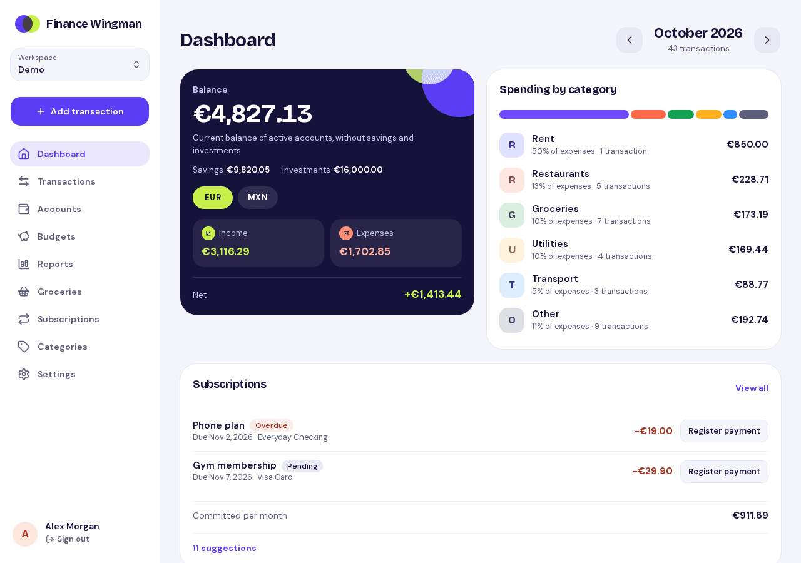
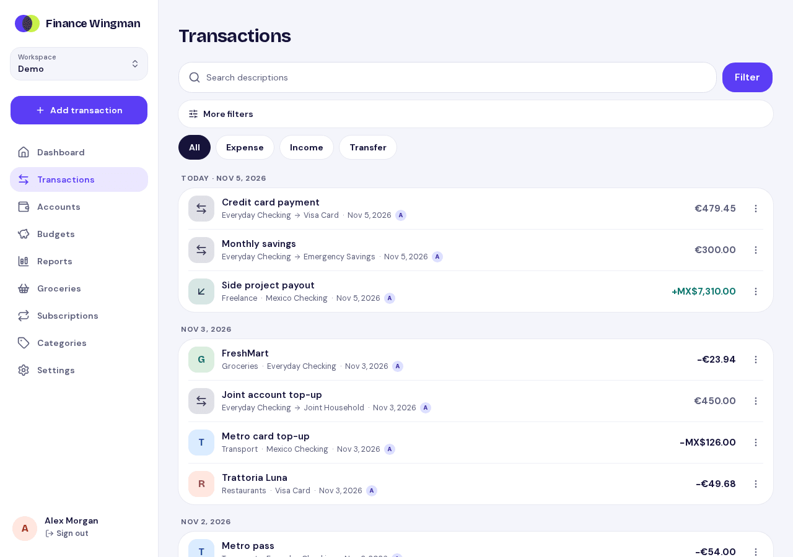
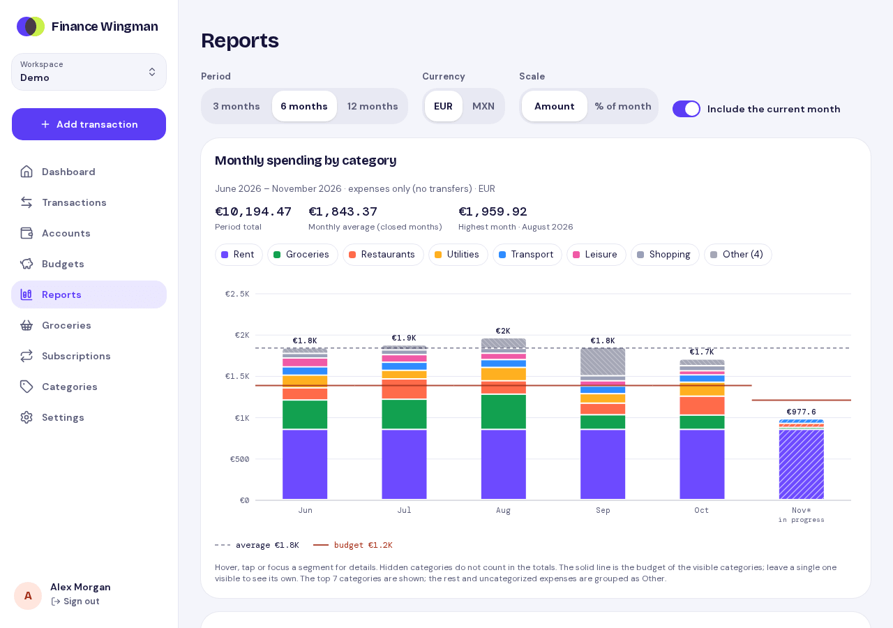
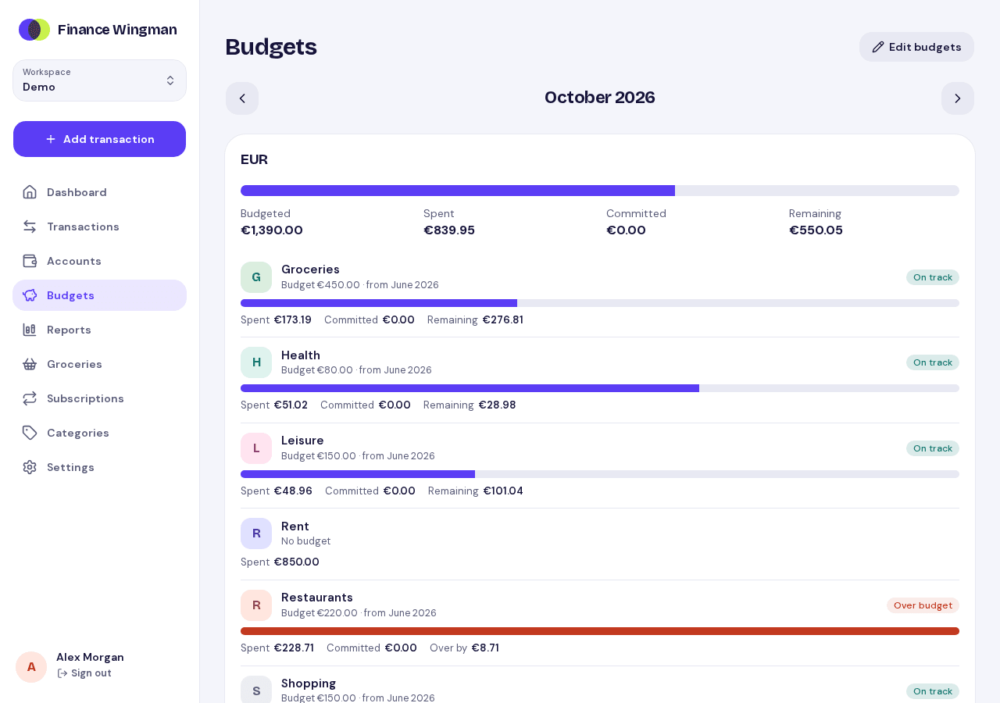
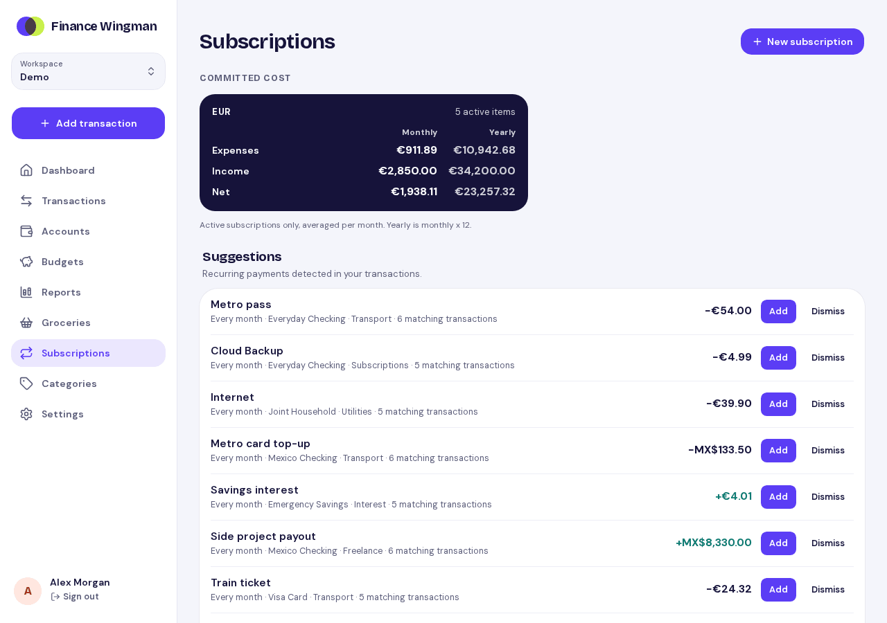
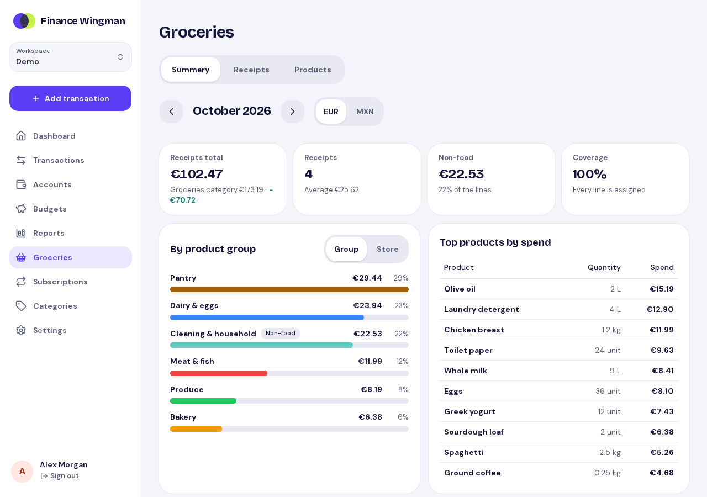
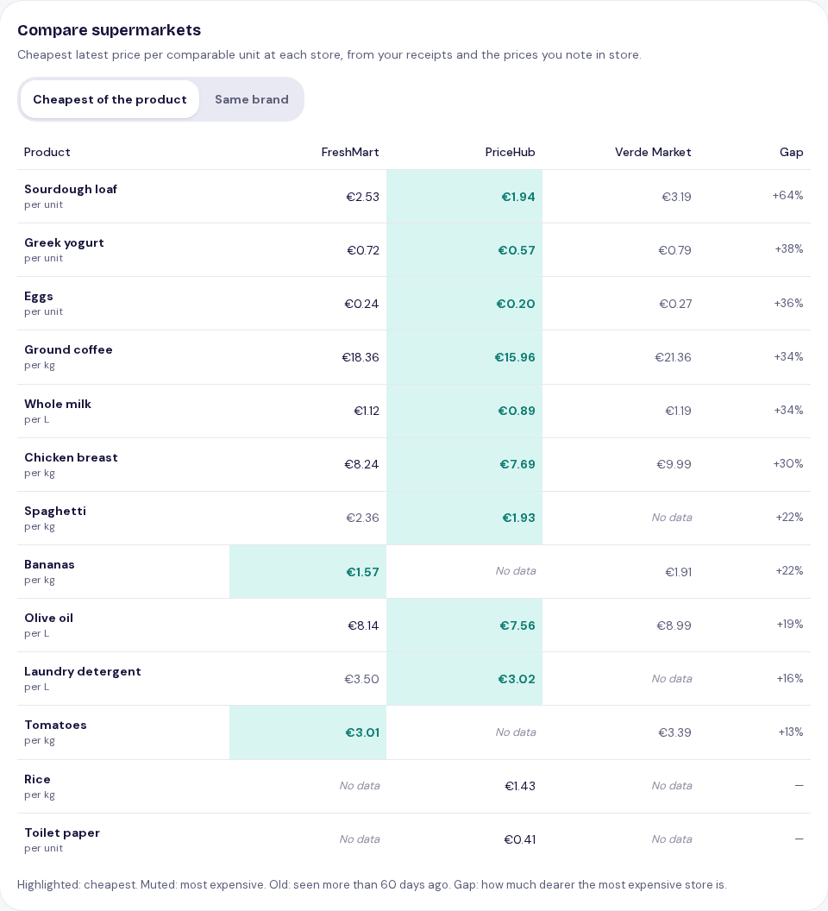
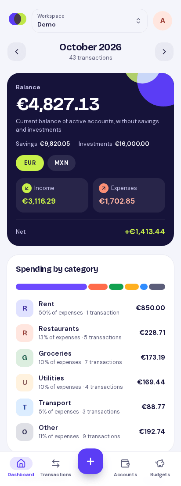
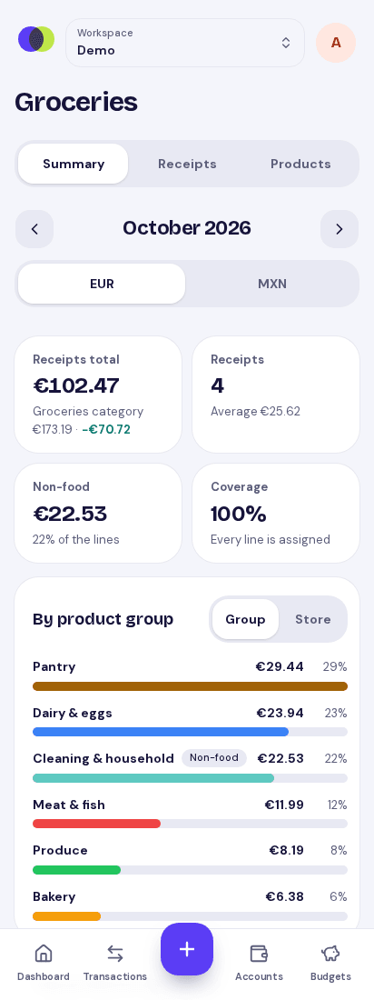
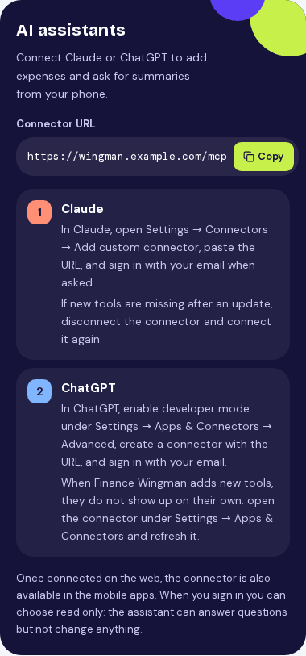

# Finance Wingman

[](https://github.com/antoniojh10/finance-wingman/actions/workflows/ci.yml)
[](LICENSE)


Personal finance app organized in workspaces shared by invitation: multiple
accounts in different currencies, categorized expenses/income, transfers,
subscriptions, budgets, reports and grocery receipts, plus an MCP server
(OAuth 2.1) so you can add and query transactions from Claude or ChatGPT
mobile.

<picture>
  <source media="(prefers-color-scheme: dark)" srcset="docs/screenshots/dashboard-desktop-dark.png">
  
</picture>

## Features

- **Workspaces**: share a household's finances by invitation; owners manage
  members, everyone manages the data. Switch between workspaces at any time.
- **Accounts**: one ISO 4217 currency each, owned by a member or shared;
  savings and investment balances are shown apart from the main balance.
- **Transactions**: expenses, income and transfers between accounts, with
  categories, search and filters. Summaries are grouped per currency and
  never convert between them.
- **Subscriptions**: recurring expenses and income with due dates, one-click
  payments, committed monthly cost, and suggestions detected from your
  transactions.
- **Budgets**: monthly limits per category, with suggestions from your
  history and warnings when a category gets near or over its limit.
- **Reports**: spending by category over 3, 6 or 12 months, with averages,
  budgets and a month-by-month comparison table.
- **Groceries**: receipts linked to expenses, a product catalog with groups,
  spending by group and store, and a price comparison across supermarkets.
- **Assistants (MCP)**: Claude and ChatGPT connect through OAuth with the
  same email sign-in; connections can be read-only.
- **Security and privacy**: passwordless sign-in, row-level security per
  workspace, rate limiting, active sessions and connections you can revoke,
  an activity log, data export and workspace deletion.
- **Languages**: English and Spanish.

## Screenshots

Generated from fictional data with `make screenshots` (see
[docs/screenshots](docs/screenshots)); they follow your light or dark theme.

| | |
| --- | --- |
| <picture><source media="(prefers-color-scheme: dark)" srcset="docs/screenshots/transactions-desktop-dark.png"></picture> Transactions grouped by day, with search and type filters. | <picture><source media="(prefers-color-scheme: dark)" srcset="docs/screenshots/reports-desktop-dark.png"></picture> Monthly spending by category over six months, with the average and budget lines. |
| <picture><source media="(prefers-color-scheme: dark)" srcset="docs/screenshots/budgets-desktop-dark.png"></picture> Budgets per category with spent, committed and remaining amounts. | <picture><source media="(prefers-color-scheme: dark)" srcset="docs/screenshots/recurring-desktop-dark.png"></picture> Committed monthly and yearly cost, and recurring payments detected in your transactions. |
| <picture><source media="(prefers-color-scheme: dark)" srcset="docs/screenshots/groceries-desktop-dark.png"></picture> Grocery receipts for the month, spending by product group and top products. | <picture><source media="(prefers-color-scheme: dark)" srcset="docs/screenshots/store-comparison-desktop-dark.png"></picture> Cheapest price per unit at each supermarket and the gap between stores. |

On a phone:

| | | |
| --- | --- | --- |
| <picture><source media="(prefers-color-scheme: dark)" srcset="docs/screenshots/dashboard-mobile-dark.png"></picture> | <picture><source media="(prefers-color-scheme: dark)" srcset="docs/screenshots/groceries-mobile-dark.png"></picture> | <picture><source media="(prefers-color-scheme: dark)" srcset="docs/screenshots/assistants-mobile-dark.png"></picture> |
| Dashboard | Groceries | Connecting Claude or ChatGPT |

## Structure

```
apps/api   Go API (REST + MCP), PostgreSQL migrations
apps/web   Next.js frontend (see apps/web/README.md)
infra      Local infrastructure (Postgres init scripts)
```

## Requirements

- Go 1.27+
- Node.js 24 and pnpm 10+
- Docker (with Compose)

## Getting started

```bash
cp .env.example .env
make up          # Postgres on :5432, Mailpit on :8025
make api-run     # API on :8080 (applies migrations on start)
make web-install && make web-dev   # Web on :3000
```

Grant access to the first users (no public sign-up), then sign in with the
link or code that arrives in Mailpit:

```bash
# in .env; on startup they own a first workspace (INITIAL_WORKSPACE_NAME)
INITIAL_USERS="you@example.com:You,partner@example.com:Partner"
```

Everyone else joins by invitation from a workspace's settings page. Users
added with `go run ./cmd/api users add` start without a workspace and are
asked to create one.

- Health check: http://localhost:8080/healthz
- API docs: http://localhost:8080/docs
- OpenAPI spec: http://localhost:8080/openapi.json
- Mailpit inbox: http://localhost:8025

## Common tasks

| Command | Description |
| --- | --- |
| `make api-test` | Run all API tests (requires `make up`) |
| `make api-generate` | Regenerate sqlc code after editing SQL |
| `make api-lint` | `go vet` + `gofmt` check |
| `make web-test` / `make web-lint` | Web unit tests / lint + typecheck |
| `make web-e2e` | Playwright end-to-end tests (needs `make up`) |
| `make api-openapi` | Export the OpenAPI document and regenerate web API types |
| `make migrate-up` / `migrate-down` / `migrate-status` | Manage migrations |
| `make migrate-new name=add_x` | Create a new SQL migration |
| `make demo-seed email=you@example.com [reset=1]` | Seed a "Demo" workspace with fictional data for the existing user (`reset=1` replaces it; see [docs](docs/deploy-railway.md#demo-data)) |
| `make screenshots` | Regenerate `docs/screenshots` from the demo workspace (needs `make up`) |
| `make psql` | Open a psql shell |
| `make measure` | Measure RAM/CPU of the production images and estimate hosting cost ([docs](docs/measure.md)) |
| `go run ./cmd/api users list\|add\|remove` | Manage who has access (from `apps/api`) |

## Authentication

- `POST /api/v1/auth/login` emails a magic link and a 6-digit code (15 min, single use).
- `POST /api/v1/auth/verify` exchanges the link token or email + code for a bearer token.
- Every other `/api/v1` endpoint requires `Authorization: Bearer <token>`.
- The web app keeps the token server-side (Next.js acts as a backend-for-frontend).

## MCP (Claude / ChatGPT)

The API serves a remote MCP server at `PUBLIC_URL/mcp` (Streamable HTTP,
stateless) protected by OAuth 2.1:

- Discovery: `/.well-known/oauth-protected-resource` and `/.well-known/oauth-authorization-server`
- Dynamic client registration (`/oauth/register`), authorization code + PKCE (S256), rotating refresh tokens, revocation
- During authorization the user receives a 6-digit code by email and types it on the consent page, which works inside mobile in-app browsers

Tools:

- Transactions: `add_expense`, `add_income`, `add_transfer`, `add_transactions`, `list_transactions`, `update_transaction`, `update_transactions`, `delete_transaction`, `get_summary`
- Accounts: `list_accounts`, `create_account`, `create_accounts`, `update_account`
- Categories: `list_categories`, `create_category`, `create_categories`, `update_category`
- Recurring: `list_recurring`, `create_recurring`, `update_recurring`, `list_upcoming_recurring`, `mark_recurring_paid`, `link_transaction_to_recurring`, `list_recurring_suggestions`, `accept_recurring_suggestion`, `dismiss_recurring_suggestion`
- Budgets: `get_budget_status`, `set_budgets`, `suggest_budgets`; expense tools add a warning when a category gets near or over its budget
- Reports: `get_monthly_spending`
- Groceries: `add_receipt`, `list_receipts`, `get_receipt`, `assign_receipt_lines`, `list_grocery_catalog`, `update_grocery_product`, `get_grocery_breakdown`, `add_price_check`, `compare_stores`, `price_shopping_list`

Connections can be authorized read-only (`finance:read`); they can then only
use the tools that read data.

Amounts are decimals in the account currency; summaries never mix currencies.
Accounts belong to a workspace member or are shared: a bare account name
means the caller's own, and another member's is written as `BNP (Ana)`.

To connect, add a custom connector with the URL `https://<your-api>/mcp`:

- **Claude**: Settings → Connectors → Add custom connector (available in the mobile app once added).
- **ChatGPT**: Settings → Apps & Connectors → Advanced → Developer mode → Create connector.

The MCP endpoint must be reachable over public HTTPS; for local testing use a
tunnel (e.g. `cloudflared tunnel --url http://localhost:8080`) and set
`PUBLIC_URL` to the tunnel URL.

## Deployment

Production runs on Railway, which deploys each app from `main` when its
folder changes. To deploy a service by hand (e.g. after a commit that
skipped it), run the **Deploy** workflow from the Actions tab and pick
`api`, `web` or `both`; it only deploys `main`. It needs the
`RAILWAY_TOKEN` repository secret: a Railway project token for the
`production` environment.

See [docs/deploy-railway.md](docs/deploy-railway.md) for deploying the API,
web app and PostgreSQL on Railway (the Dockerfiles also run on any
container host).

See [docs/backups.md](docs/backups.md) for manual production backups
(`make prod-backup`) and restores.

See [docs/observability.md](docs/observability.md) to send traces,
metrics and logs to an OpenTelemetry backend.

## Contributing and security

See [CONTRIBUTING.md](CONTRIBUTING.md) and [AGENTS.md](AGENTS.md) for the
contribution rules, and [SECURITY.md](SECURITY.md) to report a vulnerability.

## License

[MIT](LICENSE) © 2026 Antonio Hernández
